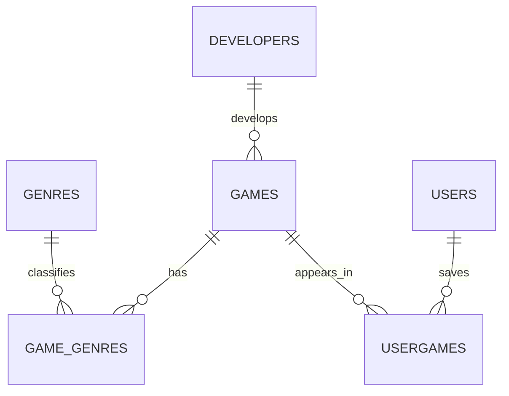

# Game Library Project Plan

## Project idea

Build a game library where a user can browse a catalog, find a game, and open
its saved launch URL. A user can also keep a personal list of games, a rating,
and a play count. The URLs may lead to official or store pages; hosting complete
games inside this project is not part of this scope.

## Proposed data model



- Each game has one developer; one developer can be connected to many games.
- Games and genres have a many-to-many relationship through `game_genres`.
- Users and games have a many-to-many relationship. `user_games` is the
  junction table: a user can save many games, and a game can appear in many
  users' libraries.
- The `user_games` composite primary key `(user_id, game_id)` allows a given
  game to appear only once in each user's library.
- Each table has a primary key. Foreign keys, unique usernames/emails, valid
  dates and URLs, ratings from 1–5, and non-negative play counts protect the
  data.

### Why this is normalized

Developer names are stored once in `developers`. Genre names are stored once
in `genres`, and `game_genres` connects them to games. Users and games are
stored separately and connected through `user_games`. The rating and play
count describe one user's relationship with one game, so those values belong
in `user_games`, not directly in `games` or `users`. No intentional
denormalization is planned.

## Possible features

1. Browse all games and sort them by title.
2. Search for a game by title.
3. Filter the catalog by genre.
4. Open a selected game's saved URL.
5. View one user's saved games, ratings, and play counts.
6. Add, edit, and delete games and developers.

The console menu covers browsing, searching, genre filtering, opening links,
user libraries, and reports. It also supports full CRUD for games and
developers.

## Questions the database can answer

1. Which games belong to a selected genre?
2. Which games has a user saved, and what are their ratings and play counts?
3. How many games has each user saved?
4. Which games have the highest average rating?

Example SQL answers:

```sql
-- 1. Games in the Puzzle genre.
SELECT g.title, g.published_on, d.name AS developer
FROM games AS g
JOIN developers AS d ON d.developer_id = g.developer_id
JOIN game_genres AS gg ON gg.game_id = g.game_id
JOIN genres AS ge ON ge.genre_id = gg.genre_id
WHERE ge.genre_name = 'Puzzle'
ORDER BY g.title;

-- 2. One user's saved games (joins four tables).
SELECT u.username, g.title, ge.genre_name, d.name AS developer,
       ug.rating, ug.play_count
FROM users AS u
JOIN user_games AS ug ON ug.user_id = u.user_id
JOIN games AS g ON g.game_id = ug.game_id
JOIN developers AS d ON d.developer_id = g.developer_id
JOIN game_genres AS gg ON gg.game_id = g.game_id
JOIN genres AS ge ON ge.genre_id = gg.genre_id
WHERE u.username = 'player01'
ORDER BY g.title;

-- 3. Number of saved games per user.
SELECT u.username, COUNT(ug.game_id) AS saved_games
FROM users AS u
LEFT JOIN user_games AS ug ON ug.user_id = u.user_id
GROUP BY u.user_id, u.username
ORDER BY saved_games DESC, u.username;

-- 4. Highest-rated games, requiring at least two ratings.
SELECT g.title, ROUND(AVG(ug.rating), 2) AS average_rating,
       COUNT(ug.rating) AS rating_count
FROM games AS g
JOIN user_games AS ug ON ug.game_id = g.game_id
GROUP BY g.game_id, g.title
HAVING COUNT(ug.rating) >= 2
ORDER BY average_rating DESC, rating_count DESC;
```

The second query satisfies the three-or-more-table JOIN requirement. The third
demonstrates `GROUP BY` and `COUNT`. For the Java-algorithm requirement, sort
the loaded game list in Java rather than relying only on SQL `ORDER BY`.

## Work through the assignment in this order

### Week 1 — Proposal

- Confirm the topic and who the app is for.
- Pick at least five features from the list above.
- Choose at least three database questions to answer.

### Week 2 — Data model

- Review this ER diagram with your teacher and make any requested changes.
- Understand how the tables and their keys relate.
- Run `schema.sql` first, then `seed.sql`, and inspect the tables in SQLite.
- Write a short explanation of the normalization choices above.
- Get teacher approval before building more Java features.

### Week 3 — Database layer

- Create Java models for `Game`, `Developer`, `Genre`, `User`, and `UserGame`.
- Keep database code in DAO classes rather than mixing it into the menu.
- Add and test full CRUD for games and developers.
- Use `PreparedStatement` for every value supplied by a user.

### Weeks 4–5 — Application

- Build a menu-driven app to browse, search, and manage the library.
- Include at least two JOIN queries; one must span three or more tables.
- Add a `GROUP BY` query with an aggregate such as `COUNT` or `AVG`.
- Add a Java algorithm, such as sorting games by title or release date.
- Validate input and handle missing records and database errors.
- Open links with the user's browser rather than trying to host games in the app.

### Week 6 — Polish and testing

- Test empty searches, duplicate usernames/emails, invalid dates, invalid
  ratings, negative play counts, and references to missing users or games.
- Finish the README with setup instructions and the schema.
- Include 3–5 database questions with their SQL answers.
- Write the reflection about what you would change in the schema.

### Week 7 — Demo

- Prepare a five-minute walkthrough.
- Show the app running, demonstrate a query, and explain the many-to-many
  relationship between users and games.
