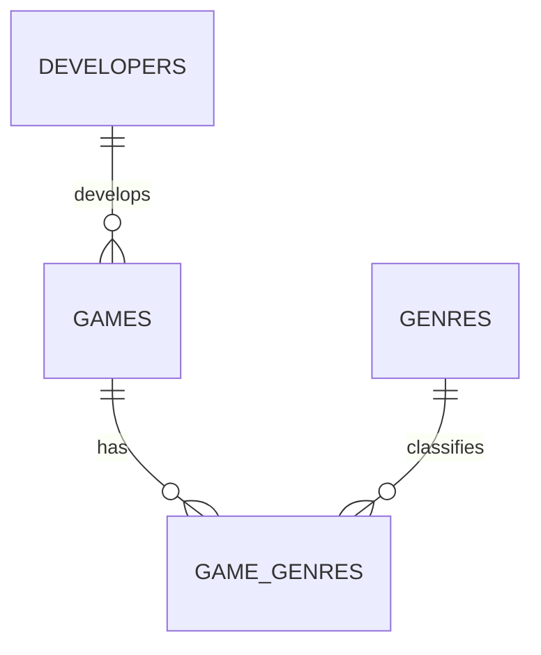

# Game Library Project Plan

## Recommended scope

Build a catalog of games. A user can browse or search the list, see a game's
release date, developer, and genres, and open its saved web page. The saved URL
may point to an official page or a store listing. Hosting or embedding complete
games is a separate, much larger project and is not needed for this assignment.

## Proposed data model



- One developer can be connected to many games; each game has one developer.
- A game can have multiple genres, and each genre can describe multiple games.
  `game_genres` is the junction table that stores those pairs.
- Each table has a primary key. Foreign keys connect related records, and
  uniqueness, non-empty values, URL checks, and date checks help reject bad data.

### Why this is normalized

Developer names are stored once in `developers`, not repeated as free text in
every game row. Genre names are stored once in `genres`, and the junction table
connects them to games instead of putting a comma-separated list in `games`.
Each row therefore describes one developer, one game, one genre, or one
game-genre connection; no intentional denormalization is planned.

## Possible features

1. List games, sorted by title or release date.
2. Search games by title.
3. Add, edit, and delete games.
4. Add, edit, and delete developers.
5. Assign genres and filter the catalog by genre.
6. Open a selected game's saved URL in a browser.

For the rubric, make sure the finished app supports full create, read, update,
and delete operations for at least two entities, such as games and developers.

## Questions the database can answer

1. Which games belong to a chosen genre?
2. How many games are listed for each developer?
3. Which games have the newest release dates?
4. Which games have more than one genre?

Example SQL answers:

```sql
-- 1. Games in the Action genre (joins four tables).
SELECT g.title, g.published_on, d.name AS developer
FROM games AS g
JOIN developers AS d ON d.developer_id = g.developer_id
JOIN game_genres AS gg ON gg.game_id = g.game_id
JOIN genres AS ge ON ge.genre_id = gg.genre_id
WHERE ge.name = 'Action'
ORDER BY g.title;

-- 2. Number of games per developer, including developers with no games.
SELECT d.name AS developer, COUNT(g.game_id) AS game_count
FROM developers AS d
LEFT JOIN games AS g ON g.developer_id = d.developer_id
GROUP BY d.developer_id, d.name
ORDER BY game_count DESC, d.name;

-- 3. Five games with the newest publication dates.
SELECT title, published_on
FROM games
ORDER BY published_on DESC
LIMIT 5;

-- 4. Games assigned to more than one genre.
SELECT g.title, COUNT(gg.genre_id) AS genre_count
FROM games AS g
JOIN game_genres AS gg ON gg.game_id = g.game_id
GROUP BY g.game_id, g.title
HAVING COUNT(gg.genre_id) > 1
ORDER BY genre_count DESC, g.title;
```

The first query satisfies the three-or-more-table JOIN requirement. The second
demonstrates `GROUP BY` and `COUNT`. For the Java algorithm requirement, load
games and sort them in Java rather than using SQL's `ORDER BY` for that feature.

## Work through the assignment in this order

### Week 1 — Proposal

- Confirm the topic and who the app is for.
- Pick at least five features from the list above.
- Choose at least three database questions to answer.

### Week 2 — Data model

- Review the ER diagram above and adjust it with your teacher.
- Read `schema.sql` and understand each table, primary key, foreign key, and
  constraint.
- Import `schema.sql`, then `seed.sql`, into SQLite and inspect the sample rows.
- Write a short explanation of why developers, games, and genres are separate.
- Get teacher approval before building the app's Java features.

### Week 3 — Database layer

- Create Java model classes for `Game`, `Developer`, and `Genre`.
- Create DAO classes to keep SQL separate from the menu and program logic.
- Add and test CRUD operations for at least two entities.
- Use `PreparedStatement` for every value supplied by a user.

### Weeks 4–5 — Application

- Build a menu-driven console app to browse, search, and manage the catalog.
- Add at least two JOIN queries; make one JOIN across three or more tables.
- Add a `GROUP BY` summary query, such as games per developer or genre.
- Add a Java algorithm, such as sorting the loaded games by title or date.
- Validate input and handle missing records and database errors.
- Open links with the user's browser rather than trying to host games in the app.

### Week 6 — Polish and testing

- Test normal inputs, empty searches, duplicate values, invalid dates, and
  attempts to reference missing developers or genres.
- Finish the README with setup instructions and the schema.
- Include 3–5 database questions with the SQL used to answer them.
- Write the reflection about what you would change in the schema.

### Week 7 — Demo

- Prepare a five-minute walkthrough.
- Show the app running, demonstrate a query, and explain the ER diagram and
  many-to-many relationship.
